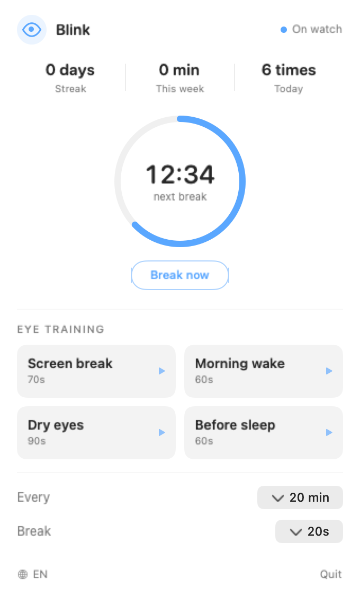

# Blink

**Eye breaks your eyes can actually feel.**

A macOS menu bar app that interrupts long screen sessions with a full-screen rest — then walks your eyes through a short routine: follow a dot, trace a circle, shift focus far and near, and finally close them.

No camera. No gaze tracking. No screen capture. No network.

**[中文说明](README.zh-CN.md)**



## Why another break reminder

Every break app tells you to look away. Twenty seconds later you go back to the same stare, and nothing has changed.

Blink treats the break as something you *do*, not something you wait out. The screen blurs, a ring fills up, and a dot starts moving. Your eyes follow it — off-center, in a slow circle, far then near. It takes 60 to 90 seconds and there is nothing to read.

## Install

1. Download `Blink.dmg` from the [latest release](../../releases/latest).
2. Open the dmg and **double-click「安装 Blink.command」**. Don't drag the app.
3. The menu bar gets an eye. There is no Dock icon.

The app is ad-hoc signed, not notarized, so dragging it into Applications is blocked by Gatekeeper. The included script clears the quarantine flag and installs to `/Applications`. If you'd rather do it by hand:

```bash
xattr -cr /Applications/Blink.app
open /Applications/Blink.app
```

Requires macOS 13 or later, Apple silicon or Intel.

## What's in it

- **Reminders** — interval from 5 to 240 minutes, break length from 10 seconds to 10 minutes. A small card slides down from the menu bar; it never takes focus.
- **The break** — full screen Gaussian blur, ring fills as time passes, the number counts down. Hover the ring to pause.
- **Eye training** — four 60–90 second routines: *Screen break*, *Morning wake*, *Dry eyes*, *Before sleep*. Same four movements, different order, pace and wording.
- **Step away** — after a session, turn the screen into a system update screen. Click anywhere to come back; it ends itself after 3 minutes.
- **Stats** — streak, minutes this week, rests today. All local.
- **Languages** — English and 简体中文, switchable from the panel's bottom-left globe menu, applied instantly.

## Privacy

The training is visually guided, which means nothing needs to be measured.

- No camera, microphone, or any hardware permission request — no indicator light will ever turn on.
- No eye tracking, no gaze points, no screen recording. The routine advances on a timer.
- No network access at all. Stats are written to `UserDefaults` on this Mac and disappear when you delete the app.

More in [PRIVACY.md](PRIVACY.md).

## How this differs from LookAway / Time Out

Those are reminder apps. The timer is the product, and the break is a pause.

Blink keeps the reminder because a break still has to be triggered — but the product is the two minutes after it. Blink is about what your eyes do during the break: a guided routine you follow with your eyes instead of a countdown you watch.

## Build from source

Needs Swift 6 and the Command Line Tools (full Xcode is not required).

```bash
swift build -c release   # compile
./build.sh               # assemble .app, ad-hoc sign, create build/Blink.dmg
```

To regenerate screenshots without taking over the screen:

```bash
BLINK_SNAPSHOT=1 BLINK_SNAPSHOT_LANG=en BLINK_SNAPSHOT_DIR=/tmp/shot ./.build/release/Blink
```

`BLINK_SNAPSHOT_LANG` accepts `en` or `zh`; omit it to follow the system language.

## Layout

```
Sources/Blink/
  main.swift                  App entry
  AppDelegate.swift           Wires the modules together
  AppState.swift              Settings + stats (UserDefaults)
  L10n.swift                  English / 中文 strings, one call site each
  ReminderEngine.swift        One tick per second: should we remind now?
  StatusItemController.swift  Menu bar icon, panel, auto-dismiss
  OverlayController.swift     Full-screen rest window (multi-display)
  TrainingController.swift    Routine progression
  TrainingProgram.swift       The four routines: stages, pace, copy
  CamouflageController.swift  System update pretend-screen
  HUDController.swift         The non-activating reminder card
  WelcomeWindow.swift         First-launch note
  EyeIcon.swift               Menu bar glyph
  SnapshotTool.swift          Offscreen rendering for screenshots
  Views/
    MenuPanel.swift           Panel layout (340×560)
    BreakScene.swift          Full-screen rest animation
    TrainingScene.swift       Training + finish page
    BlurBackdrop.swift        Gaussian blur backdrop
Resources/                    Info.plist, icon, installer script
Tools/                        Icon generation, video rendering
build.sh                      build → bundle → sign → dmg
```

## Status

Early, and honest about it.

- Ad-hoc signed. Works locally, but Gatekeeper will complain for anyone who downloads it — the installer script handles that.
- No notarization yet. That needs a Developer ID, and I'd rather see whether people keep it installed first.
- No gaze tracking. Macs have no TrueDepth camera, and Vision only exposes eyelid landmarks, not pupil position. That's why the routine is fixed rather than adaptive.

## License

MIT — see [LICENSE](LICENSE).
