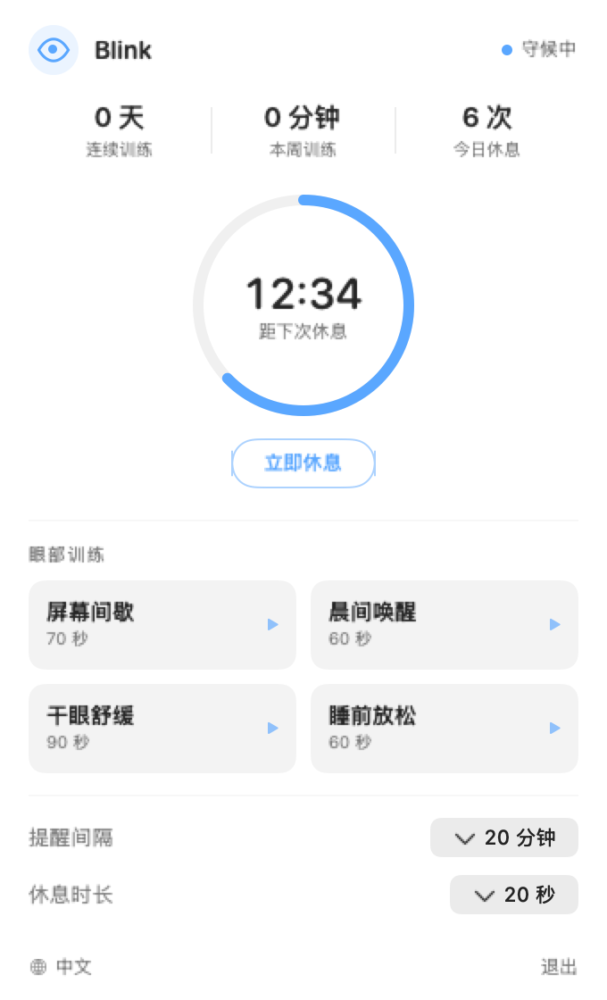
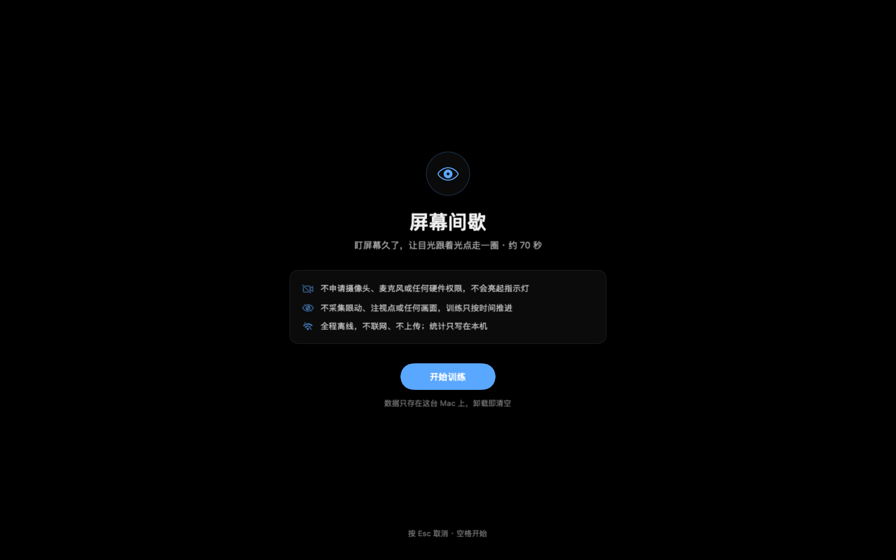
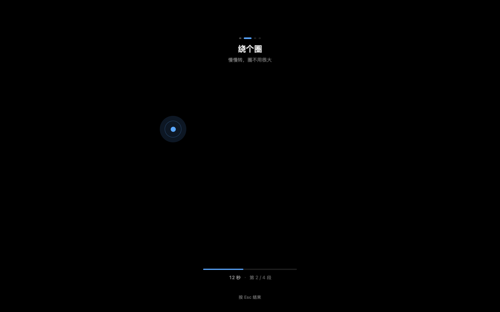
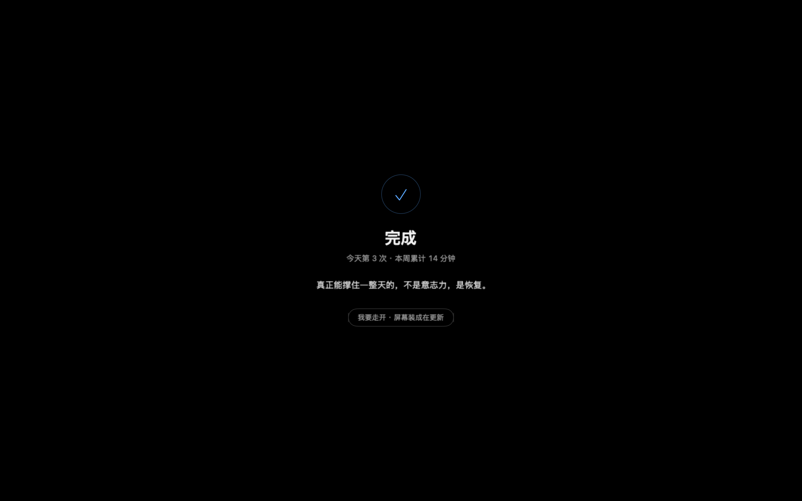
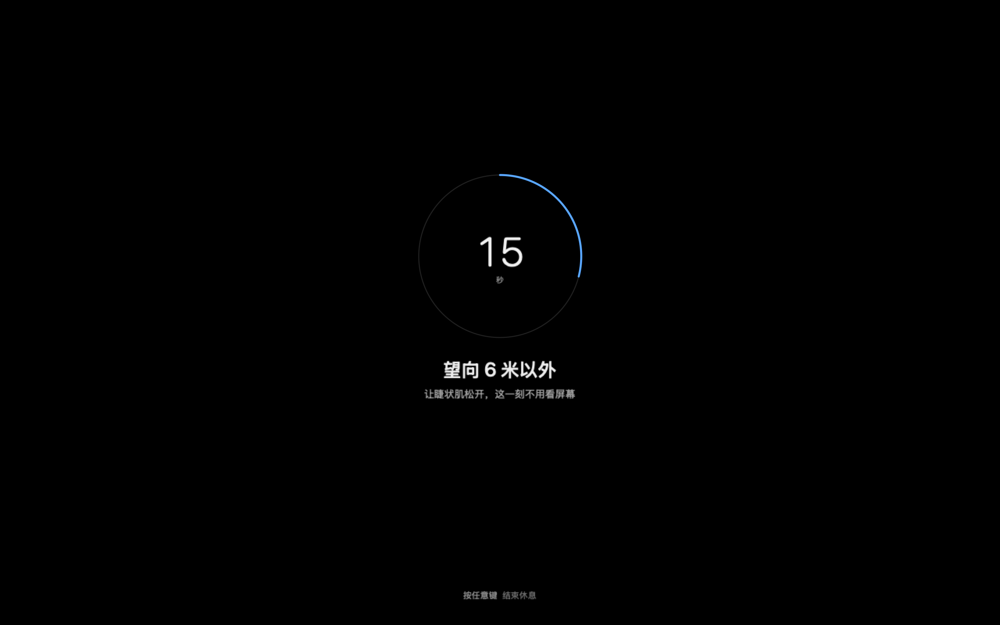
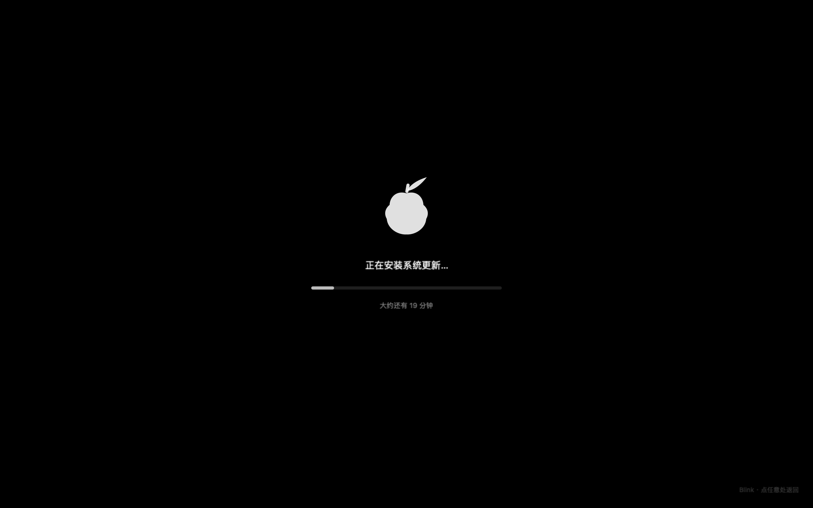
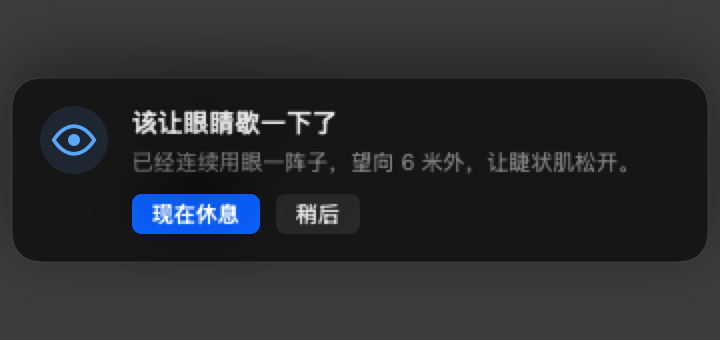

# Blink

**一次能让眼睛真正松开的休息。**

macOS 菜单栏应用。长时间盯着屏幕时，它会打断你：全屏模糊、圆环走满，然后带着眼睛做完一小套动作——跟着光点、绕一个圈、看远看近、最后闭上。

不开摄像头，不做眼动追踪，不录屏，不联网。

**[English](README.md)**

<p align="center">
  
</p>

## 为什么还要一个护眼提醒

几乎所有休息类应用都在提醒你「看远处」。看二十秒，然后回到同一个姿势，什么都没改变。

Blink 把休息当成一件要**做**的事，而不是要**熬**的时间。屏幕模糊下去，圆环开始走，一个光点开始移动。你的眼睛跟着它，离开中心、绕圈、远近切换。全程 60 到 90 秒，画面上没有字要读。

## 一次训练，三屏

<table>
<tr>
<td align="center" width="33%"><br><b>开始前</b><br><sub>说明它做什么，以及它不申请什么。</sub></td>
<td align="center" width="33%"><br><b>过程中</b><br><sub>一个光点、一个慢圈、一次远近切换。没有字要读。</sub></td>
<td align="center" width="33%"><br><b>结束后</b><br><sub>一句话，以及「我要走开」的选择。</sub></td>
</tr>
</table>

## 休息本身

背后是你自己的桌面，被系统实时高斯模糊，不是一块黑板（下图是离屏渲染的截图，实际运行时能看到你自己桌面的模糊轮廓）。圆环按已用时间顺时针长满，中间数字倒计时；鼠标移入圆环就暂停，不用找按钮。

<p align="center">
  
</p>

## 四套课程

每套 60–90 秒。同一组动作，顺序、节奏和说法不同：

| | |
|---|---|
| **屏幕间歇** | 盯屏幕久了，让目光跟着光点走一圈 |
| **晨间唤醒** | 刚醒眼睛还没对焦，动作慢一点就好 |
| **干眼舒缓** | 眼睛发涩的时候，多闭一会儿眼 |
| **睡前放松** | 关灯之前，让眼睛先松下来 |

Blink 会按当前时间和今天已经做了几套，自己挑一套。

## 我要走开

一套做完，可以把屏幕装成系统更新界面。点任意处回来，三分钟自动退出。想离开电脑一会儿，又不想让它看起来空着，就用这个。

<p align="center">
  
</p>

## 提醒

间隔 5–240 分钟，休息时长 10 秒到 10 分钟，都带预设。提醒卡从菜单栏图标下方滑出来，从不抢焦点。它还会等：你离开键盘，或者前台应用在放全屏，计时就停住，不会在你刚回来的那一刻扑上来。

<p align="center">
  
</p>

## 安装

1. 从 [Releases](../../releases/latest) 下载 `Blink.dmg`
2. 打开 dmg，**双击「安装 Blink.command」**，不要拖拽
3. 菜单栏右侧出现一只眼睛，Dock 里没有图标

应用是 ad-hoc 签名、尚未公证，所以直接拖进 Applications 会被 Gatekeeper 拦。dmg 里的脚本会清掉隔离标记并装到 `/Applications`。想手动装：

```bash
xattr -cr /Applications/Blink.app
open /Applications/Blink.app
```

要求 macOS 13 或更高，Apple 芯片与 Intel 都可以。

## 隐私

训练是纯视觉引导的，所以什么都不需要被测量。

- 不申请摄像头、麦克风或任何硬件权限，指示灯永远不会亮
- 不采集眼动、注视点，不录屏，训练只按时间推进
- 全程不联网。统计写在 `UserDefaults` 里，删掉应用就没了

细节见 [PRIVACY.md](PRIVACY.md)。

## 和 LookAway / Time Out 的区别

那些是提醒应用，计时器就是产品，休息是一段被打断的空白。

Blink 保留提醒，因为休息总得被触发；但产品是触发之后的那两分钟——眼睛要做什么。你要跟着光点走，不是盯着倒计时。

## 从源码构建

需要 Swift 6 和命令行工具（不需要完整 Xcode）。

```bash
swift build -c release   # 编译
./build.sh               # 组装 .app、ad-hoc 签名、生成 build/Blink.dmg
```

离屏渲染截图（不接管屏幕）：

```bash
BLINK_SNAPSHOT=1 BLINK_SNAPSHOT_LANG=zh BLINK_SNAPSHOT_DIR=/tmp/shot ./.build/release/Blink
```

## 目录

```
Sources/Blink/
  main.swift                  入口
  AppDelegate.swift           串联各模块
  AppState.swift              设置项与统计（UserDefaults）
  L10n.swift                  中英文案，调用点各写一版
  ReminderEngine.swift        每秒一跳，判断该不该提醒
  StatusItemController.swift  菜单栏图标与面板，含自动收起
  OverlayController.swift     全屏休息窗口（多显示器）
  TrainingController.swift    训练流程推进
  TrainingProgram.swift       四套课程：分段、时长、文案
  CamouflageController.swift  系统更新伪装页
  HUDController.swift         不抢焦点的提醒卡
  WelcomeWindow.swift         首次启动说明
  EyeIcon.swift               菜单栏图标绘制
  SnapshotTool.swift          离屏渲染截图
  Views/
    MenuPanel.swift           面板布局（340×560）
    BreakScene.swift          全屏休息动画
    TrainingScene.swift       训练界面与完成页
    BlurBackdrop.swift        高斯模糊背景
Resources/                    Info.plist、图标、dmg 内安装脚本
Tools/                        图标生成、视频渲染
build.sh                      编译 → 组装 → 签名 → 打 dmg
```

## 现状

早期版本，如实说明：

- ad-hoc 签名，本机可用；别人下载会被 Gatekeeper 拦，dmg 里的脚本负责处理
- 尚未公证，需要 Developer ID（$99/年）。想先看看有多少人真的会一直装着它
- 不做注视点追踪：Mac 没有 TrueDepth，Vision 只给眼睑关键点，拿不到瞳孔位置。所以动作是固定的，不是自适应的

## 许可

代码是 MIT，见 [LICENSE](LICENSE)。名字和图标不在授权范围内：你可以 fork、发布、出售，但请换个名字。见 [TRADEMARK.md](TRADEMARK.md)。
